# Guia de utilização da aplicação Biomaterial Ideal

Este guia explica, passo a passo e em linguagem simples, como usar a aplicação. As imagens são da aplicação nativa
para Windows (a versão web é igual no aspeto e nas funções). Em qualquer ecrã, o aviso é o mesmo: **é uma ferramenta
educativa de exploração de critérios, não é uma ferramenta clínica nem uma recomendação terapêutica.**

## 1. Para que serve

A aplicação compara biomateriais para cinco dispositivos: haste femoral, par articular da anca, implante dentário, stent
expansível por balão e scaffold ósseo. Para cada um usa uma base de dados com a fonte e o estado de cada valor, três
métodos de decisão (TOPSIS, WASPAS e VIKOR) e um consenso (Borda). Mostra também quão estável é o resultado quando os dados
ou os pesos mudam (Monte Carlo).

Os casos da haste, do stent e do scaffold têm análise completa. O par articular e o implante dentário são
semiquantitativos: o ranking é só uma indicação.

## 2. Abrir a aplicação

- **Aplicação nativa (Windows):** abrir "Biomaterial Ideal" no menu Iniciar. Instala-se com o ficheiro
  `Biomaterial Ideal_1.0.0_x64-setup.exe` (instalação silenciosa: `Biomaterial Ideal_1.0.0_x64-setup.exe /S`).
- **Versão web:** https://andremassuca.github.io/biomaterial-ideal/ (também em andremassuca.com/tp2).
- Nada do que escreve é enviado para fora: os dados do doente não são guardados, e o histórico e as definições ficam só
  neste computador.

## 3. O menu

À esquerda estão todos os ecrãs. Em cima, à direita, ficam o botão **Apresentação** (vista limpa e letra grande, para
projetar) e o botão do tema claro ou escuro.

| Ecrã | Para que serve |
|---|---|
| Início | Os cinco dispositivos e o "Espectro de confiança" (onde a escolha é clara e onde depende dos dados). |
| Como funciona | O esquema do cálculo com um exemplo, passo a passo. |
| Haste femoral, Stent, Scaffold ósseo | Ranking, pesos, Monte Carlo e materiais personalizados de cada caso. |
| Gibson e Ashby | Gráfico de rigidez e densidade, e o efeito da porosidade. |
| Fichas dos materiais | Cada valor da base com a fonte e o estado. |
| Base de triagem | Candidatos de bases abertas, não verificados (não entram nos rankings). |
| Doente | Criar um perfil de doente e ver como muda o resultado. |
| Comparar materiais | Dois materiais lado a lado. |
| Simulação FEA e CFD | Resultados das simulações da haste e do stent. |
| Histórico | As análises guardadas. |
| Filtros | Exclusões por compatibilidade com RM, esterilização e biocompatibilidade. |
| Porquê | Porque se faz assim: os valores, os métodos e as decisões. |
| Definições, Sobre | Tema, letra, movimento, modo apresentação; autoria e aviso. |

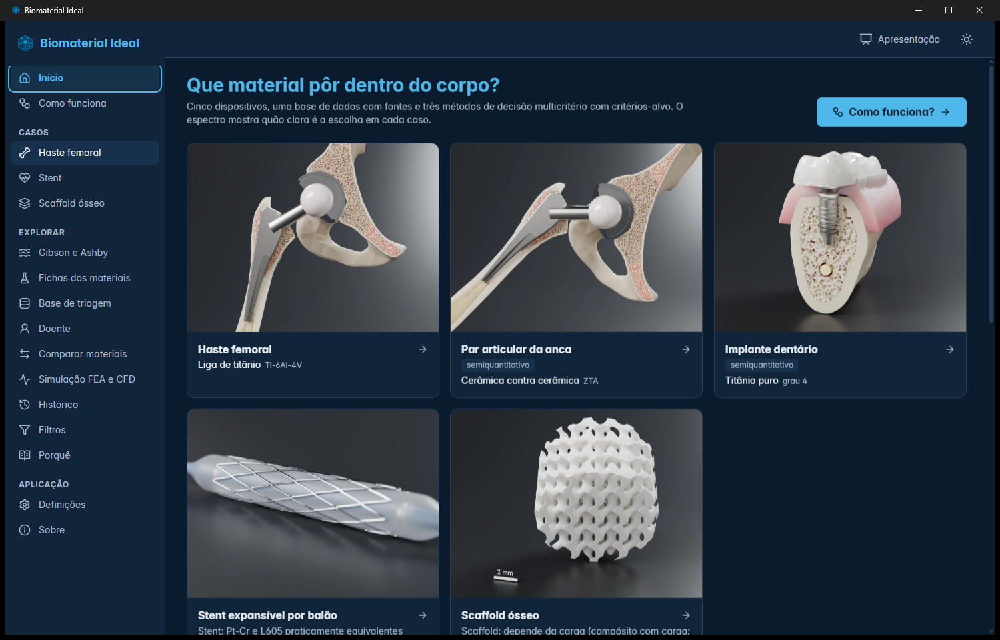

## 4. Ver um caso (haste, stent ou scaffold)

1. No menu, escolher **Haste femoral**, **Stent** ou **Scaffold ósseo**.
2. No topo, o cartão de resposta diz qual é o material em 1.º lugar no consenso e quantos dos três métodos concordam. No
   stent e no scaffold diz **"Sem vencedor universal"**, com a frase do trabalho: nestes casos a escolha depende de
   condições (por exemplo, a carga do defeito no scaffold) e a aplicação não inventa um vencedor.
3. Mais abaixo está o **Ranking** de cada método (TOPSIS, WASPAS, VIKOR) e o consenso de Borda. A coroa marca o 1.º.
4. À direita, os **Pesos dos critérios**: arrastar um cursor muda o peso e o ranking responde na hora. "Repor" volta aos
   pesos de base. O botão **Cenário A/B** troca entre "só materiais em uso clínico" e "inclui investigação e
   bioabsorvíveis". O **nível de confiança η** mistura os pesos escolhidos com pesos calculados pela dispersão dos dados.
5. **Monte Carlo:** escolher o que varia (propriedades ou pesos) e o número de repetições, e clicar **Correr**. Mostra em
   que percentagem das repetições cada material fica em 1.º lugar.

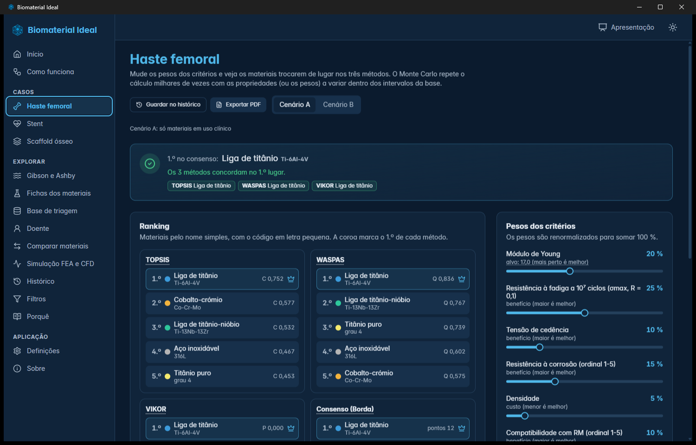

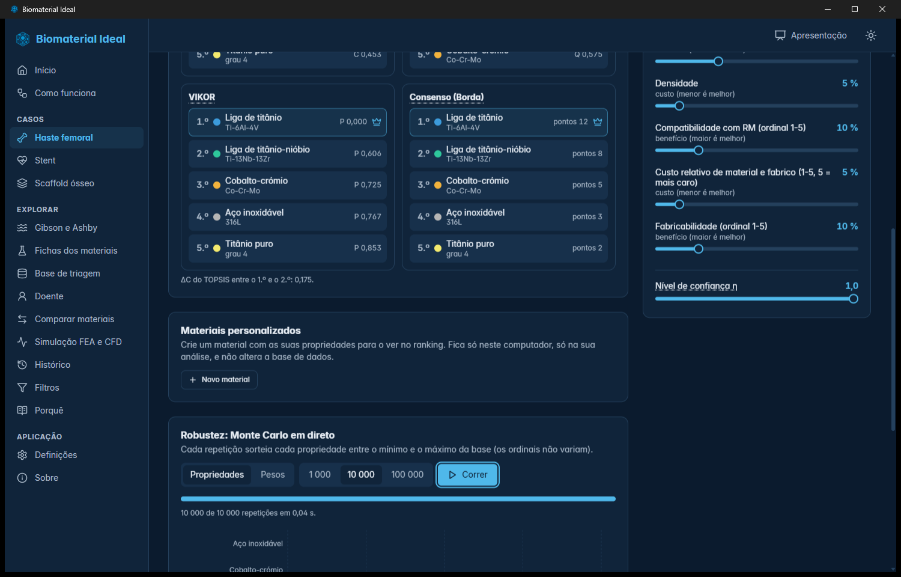

## 5. Criar um doente

O ecrã **Doente** tem quatro passos: dispositivo, dados gerais, dados do dispositivo e resultado.

1. **Dispositivo:** escolher o dispositivo. Há também perfis de exemplo para um toque.
2. **Dados gerais:** idade, sexo, IMC, atividade física, doenças (diabetes, osteoporose, função renal...), alergias e
   tratamentos. Os campos em branco ou "Não sei" não contam. Cada campo diz se **conta neste dispositivo** ou se **não tem
   regra**.
3. **Dados do dispositivo:** por exemplo, o diâmetro do vaso no stent ou se o defeito suporta carga no scaffold.
4. **Resultado:** o ranking com os dados do doente, lado a lado com o caso de base, e o que mudou.

No painel da direita vê-se, **em tempo real**, o impacto de cada dado:

- **Regras ativas:** cada regra tem um código (por exemplo, H-OST para a osteoporose na haste), a justificação escrita, a
  fonte e o estado. Os fatores de peso (normalmente 2) são **valores de desenho do trabalho**, não dados clínicos.
- **Impacto no peso dos critérios:** barras antes e depois (na osteoporose, o peso do módulo de Young sobe de 20 % para
  33 %).
- **Materiais excluídos e porquê**, e as **notas** (avisos que não mudam o ranking).

Exemplos do que as regras fazem: a alergia ao níquel no stent **não exclui** materiais, acrescenta o critério "Teor de
níquel" (regra S-NI); uma alergia confirmada por teste ao titânio ou ao cobalto exclui as ligas respetivas; um defeito
com carga no scaffold dá mais peso à resistência mecânica.

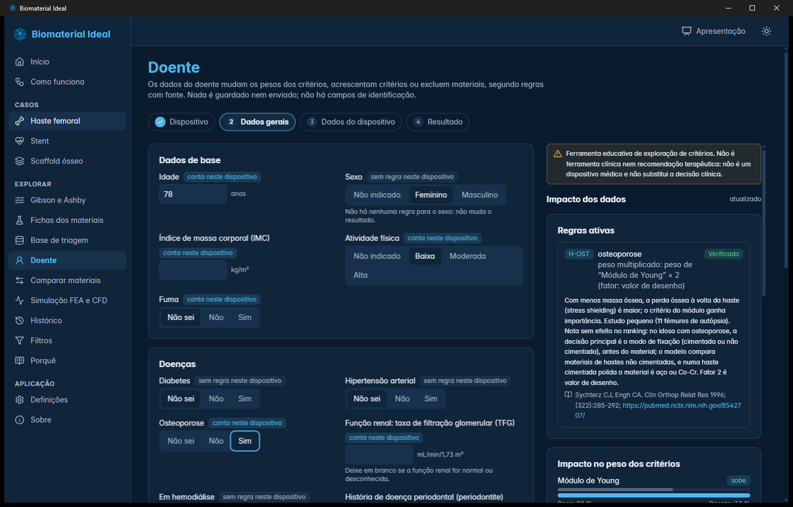

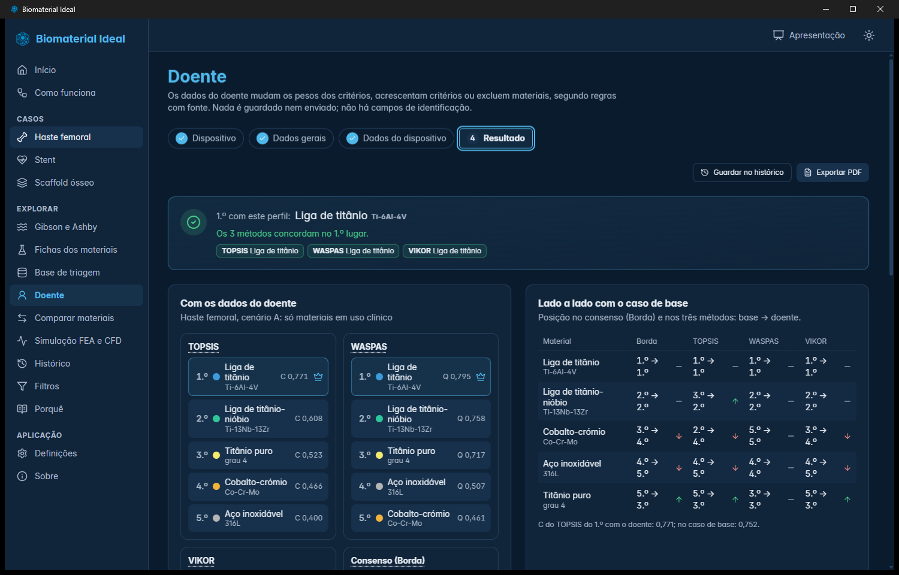

## 6. Guardar no histórico e exportar para PDF

No resultado de um caso ou de um doente há dois botões:

- **Guardar no histórico:** guarda a análise (caso, perfil, pesos, rankings, data e versão dos dados) neste computador. As
  análises ficam no ecrã **Histórico**, onde se pode abrir o relatório ou apagar cada uma. Se os dados da base mudarem
  mais tarde, o Histórico avisa que "os dados mudaram desde esta análise".
- **Exportar PDF:** abre o relatório (caso, perfil, regras, pesos, rankings dos três métodos, Monte Carlo, fontes, estado
  dos dados e limitações). Para guardar em PDF: clicar em **Imprimir ou guardar em PDF**, na janela seguinte escolher a
  impressora **"Guardar como PDF"**, clicar em **Guardar** e escolher a pasta. O nome sugerido é "Relatorio" mais o caso e
  a data.

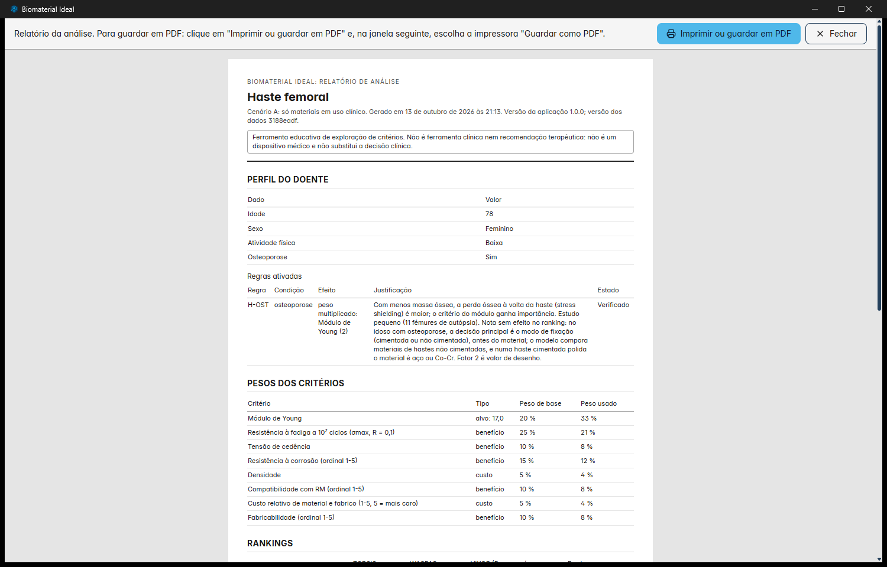

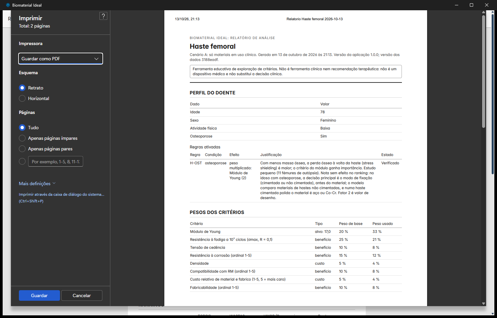

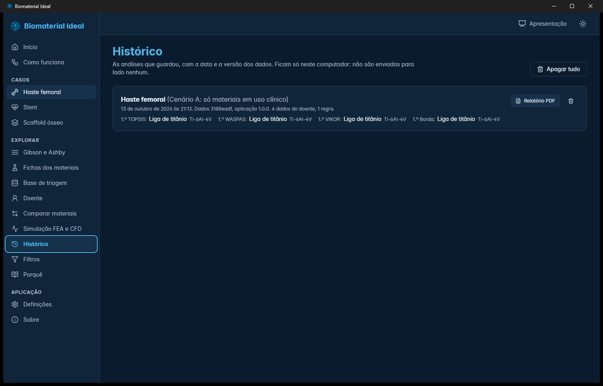

## 7. Comparar dois materiais

No ecrã **Comparar materiais** escolhe-se o caso, o cenário e dois materiais. Para cada propriedade vê-se o valor típico,
o intervalo, a **fonte** e o **estado** ("Verificado", "A verificar"...), a etiqueta "Melhor" (segundo o tipo de critério:
maior, menor ou mais perto do alvo) e a diferença. O resumo no topo diz em quantas propriedades cada um é melhor.
Quando falta um valor aparece "Sem valor na base", nunca um valor inventado. O botão **Trocar** inverte os dois materiais
e **Mostrar o radar** desenha o perfil dos dois.

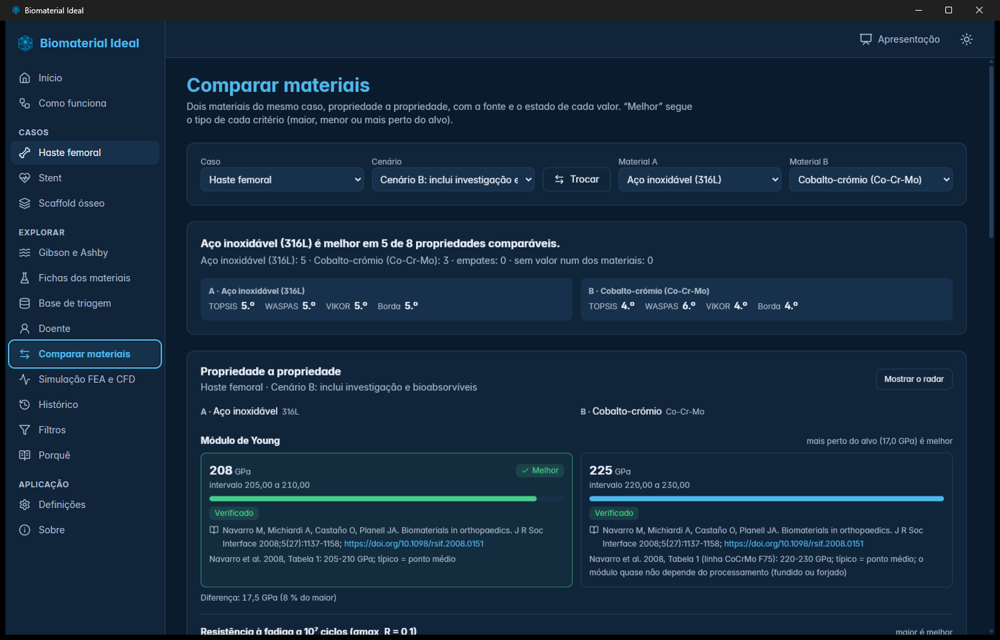

## 8. Simulação FEA e CFD

- **Haste femoral (FEA):** escolher o material e a vista. Há três vistas: **Energia de deformação** (SOLIDWORKS, a escala
  de cores vem na imagem e é própria de cada estudo), **Tensão de von Mises** (MAPDL, com a mesma escala de cores em todos
  os materiais, de 0 a 130 MPa; acima disso a cor satura; com corte coronal e vista de frente) e **Malha** (gráfico da
  malha, sem escala de tensão). Os picos de tensão são locais e dependem da malha. Clicar numa imagem amplia-a.
- **Stent (CFD):** mapas da tensão de corte na parede (TAWSS), a fração da área abaixo de 0,4 Pa, o OSI e as verificações
  numéricas.

Estas simulações são uma **verificação numérica cruzada** entre programas, não uma validação clínica nem experimental.

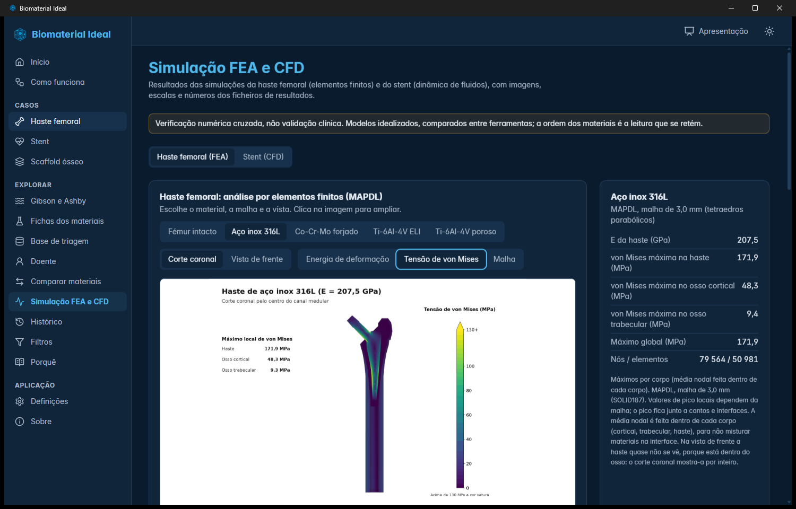

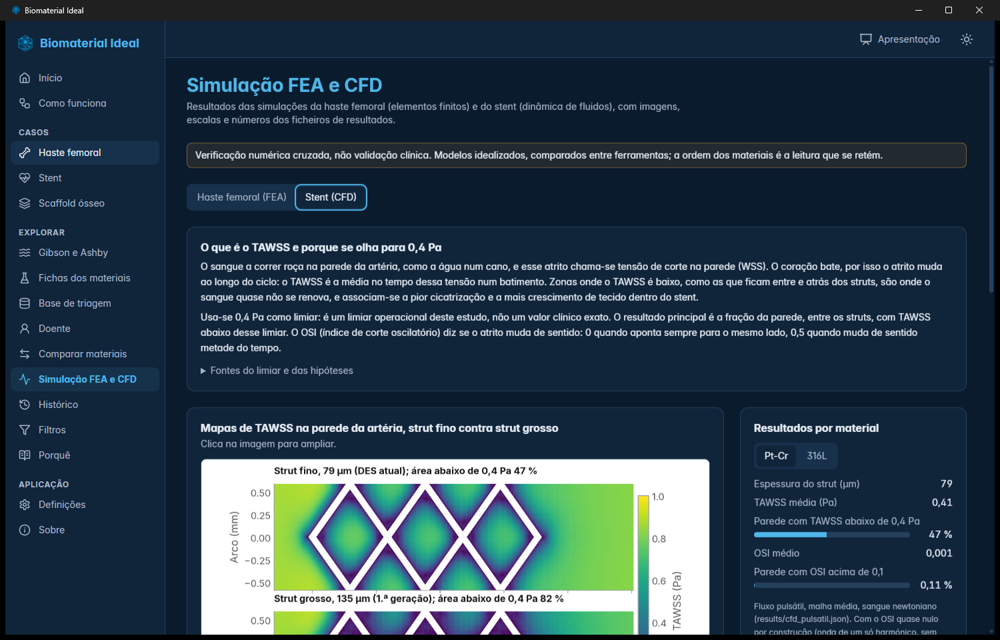

## 9. Materiais personalizados

Em cada caso, o cartão **Materiais personalizados** permite criar um material com as suas propriedades (valor típico
obrigatório em todos os critérios; mínimo e máximo opcionais; critérios ordinais com números inteiros de 1 a 5). O material
entra só no seu ranking, aparece marcado **"definido pelo utilizador"** e é guardado só neste computador; **a base de
dados não é alterada**. O Monte Carlo corre só com os materiais da base. Para o retirar, clicar no caixote do lixo.

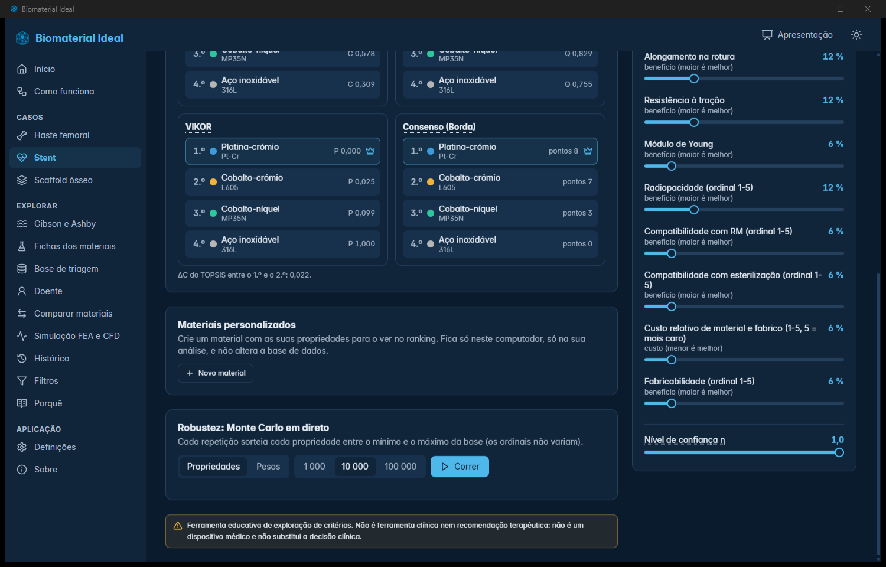

## 10. Fichas, modo apresentação e tema

- **Fichas dos materiais:** procurar um material e ver cada propriedade com unidade, intervalo, fonte e estado. Os valores
  sem fonte confirmada ficam "A verificar".
- **Modo apresentação:** o botão **Apresentação** (em cima, à direita) deixa a letra e os gráficos maiores e a barra lateral
  só com ícones, para projetar. Sai-se com o mesmo botão.
- **Tema e letra:** o botão do sol ou da lua troca o tema; em **Definições** escolhe-se o tamanho da letra e o movimento.

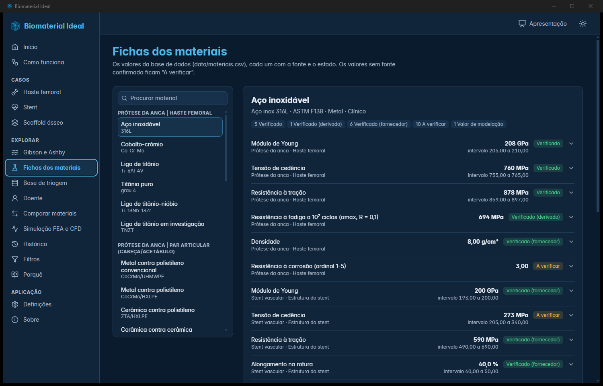

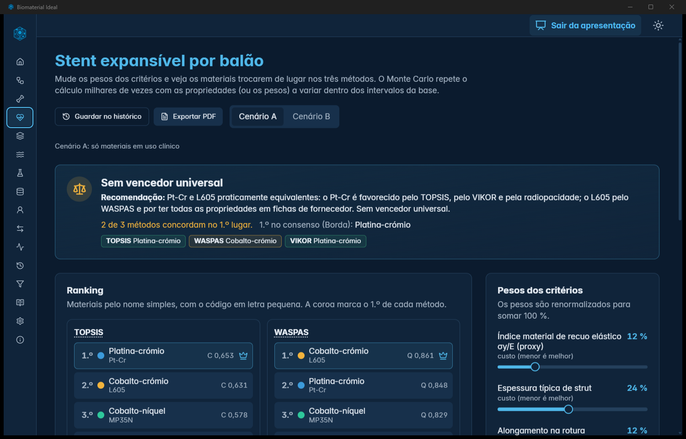

## 11. O que a aplicação não faz

- Não é uma ferramenta clínica, não substitui a decisão clínica e não recomenda um implante a um doente.
- Os pesos dos critérios e os fatores das regras do perfil são valores de desenho do trabalho; o Monte Carlo mostra o quanto o
  resultado muda quando os dados ou os pesos variam.
- Os valores marcados "A verificar" ainda não têm fonte confirmada.
- Os picos de tensão dos mapas de von Mises dependem da malha.
- Os materiais definidos pelo utilizador não passam pela verificação das fontes.

## 12. Resolução de problemas

| Problema | O que fazer |
|---|---|
| "Modo navegador: só o TOPSIS" | Está a usar uma versão sem o núcleo de cálculo completo; use a aplicação nativa ou a versão web publicada. |
| O PDF abre a impressão em vez de guardar | Na janela de impressão, escolher a impressora "Guardar como PDF" e clicar em Guardar. |
| O histórico desapareceu | O histórico fica no armazenamento da aplicação neste computador; limpar os dados do navegador ou usar outro computador apaga-o. |
| Um ecrã parece cortado | Aumentar a janela ou ligar o modo apresentação; em ecrãs pequenos a barra lateral mostra só os ícones. |
